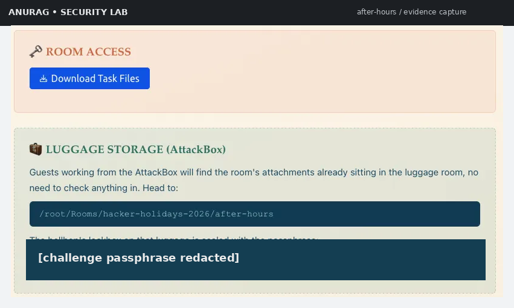
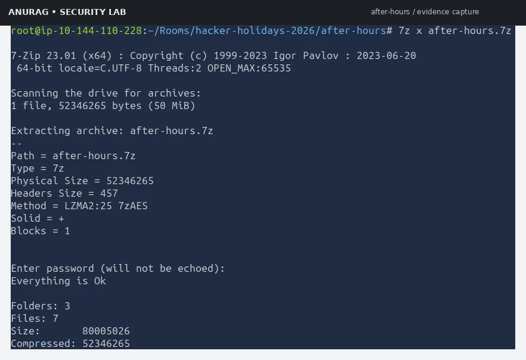
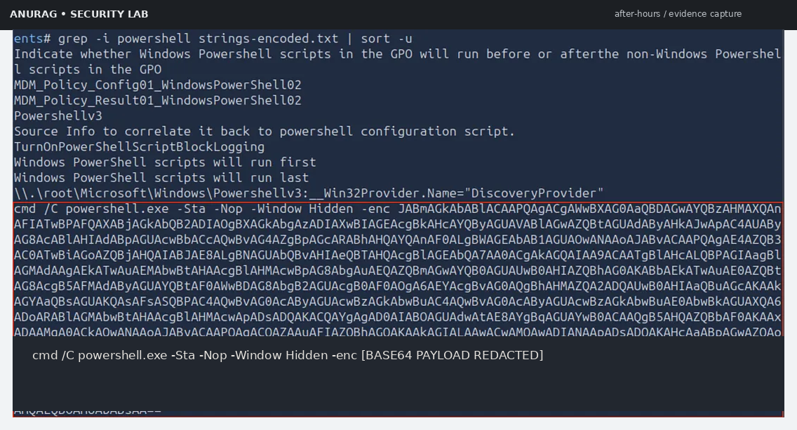
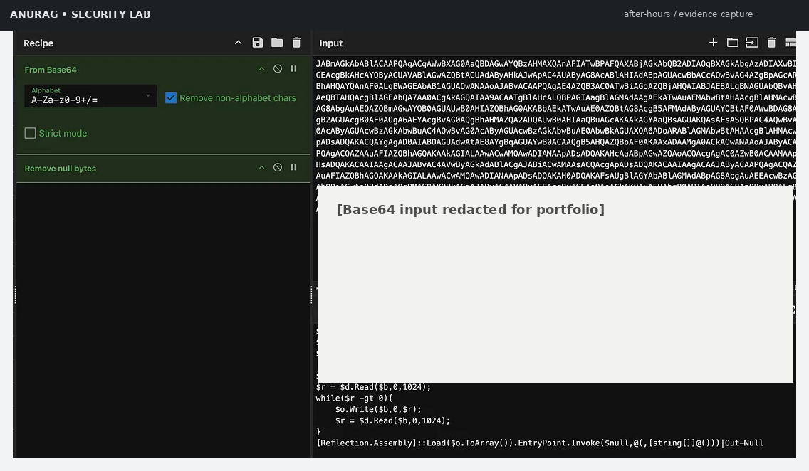
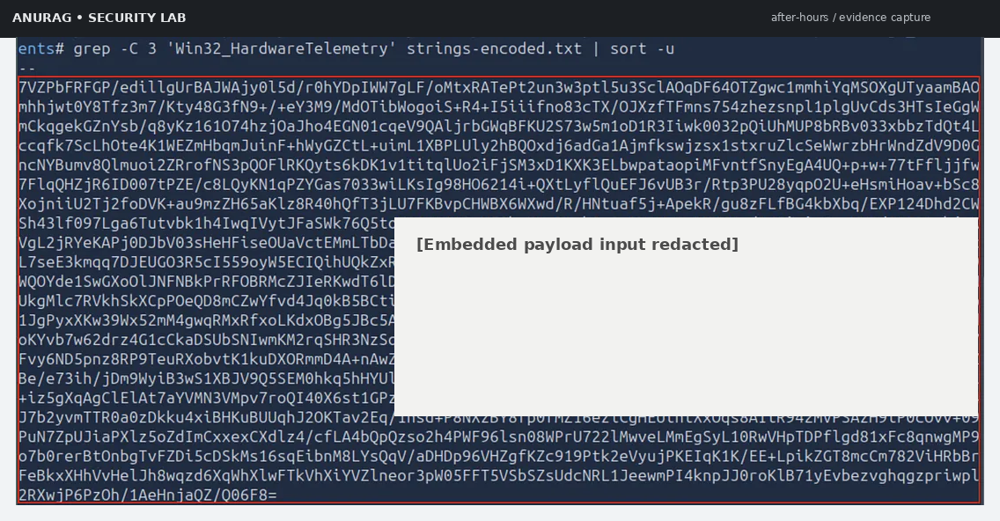
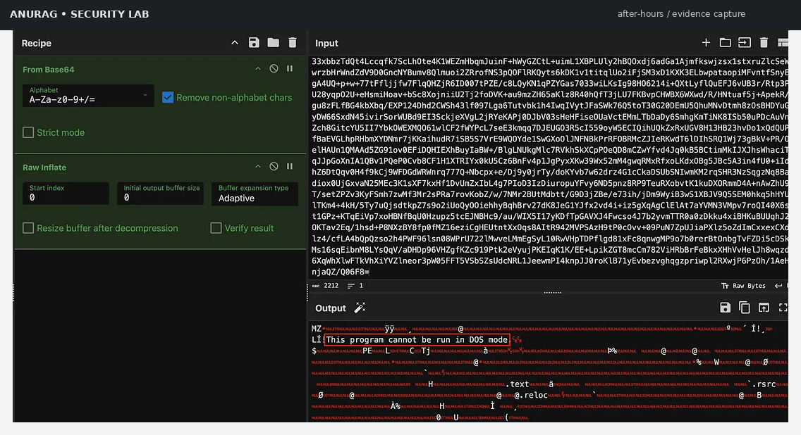
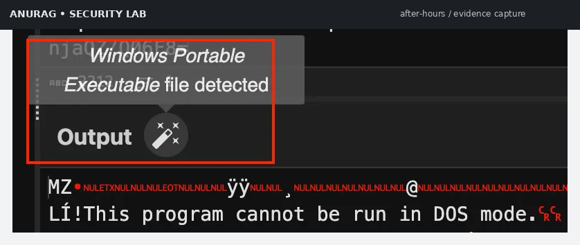
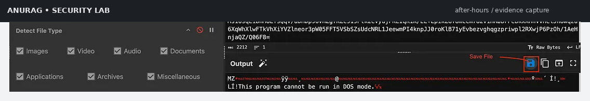
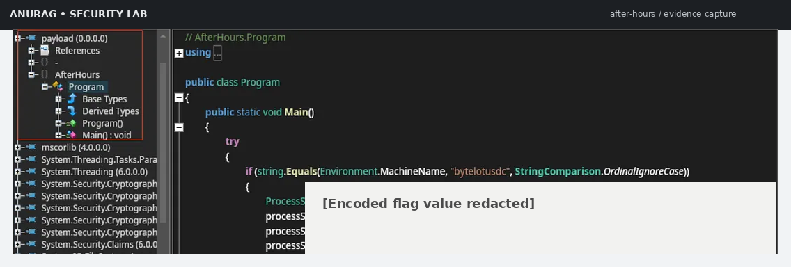
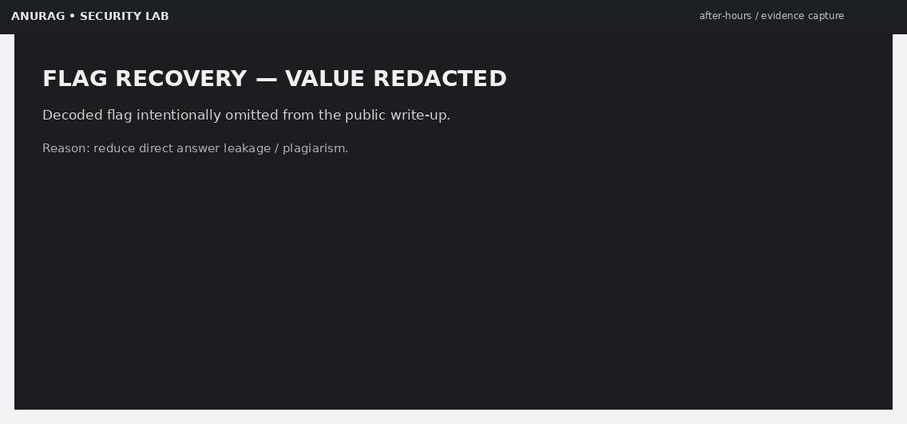

---
layout: default
title: "After Hours — Windows DFIR & Malware Analysis"
description: "A TryHackMe Windows digital forensics investigation covering PowerShell threat hunting, WMI configuration analysis, encoded payload recovery, PE validation, .NET reverse engineering, and defensive detection engineering."
category: "Digital Forensics & Incident Response"
tags:
  - TryHackMe
  - Windows-DFIR
  - PowerShell
  - WMI
  - Malware-Analysis
  - Reverse-Engineering
  - Threat-Hunting
  - Blue-Team
---

<div class="ctf-hero">

  <h1>AFTER HOURS</h1>

  <p>
    Windows Digital Forensics, Malware Analysis, and Reverse Engineering.
    Investigate suspicious after-hours activity, recover a concealed .NET
    executable from forensic artifacts, reconstruct its behavior, and develop
    defensive hunting opportunities without executing the recovered malware.
  </p>

  <div class="ctf-badges">
    <span class="ctf-badge">TryHackMe</span>
    <span class="ctf-badge">Hacker Holidays 2026</span>
    <span class="ctf-badge">Day 12</span>
    <span class="ctf-badge">Windows DFIR</span>
    <span class="ctf-badge">Malware Analysis</span>
    <span class="ctf-badge">.NET Reverse Engineering</span>
    <span class="ctf-badge">Blue Team</span>
  </div>

</div>

# Mission

This portfolio report documents the investigation of the **After Hours** TryHackMe room from Hacker Holidays 2026, Day 12.

The scenario centers on suspicious Windows activity occurring after business hours. The investigation examines forensic artifacts for encoded PowerShell execution, investigates a suspicious WMI-related configuration property, recovers compressed executable content, validates the recovered Portable Executable (PE), and analyzes its managed .NET code using ILSpy.

The investigation follows a static-first Digital Forensics and Incident Response (DFIR) workflow. The recovered executable was not intentionally executed during the documented analysis.

<div class="key-finding">
  <div class="key-finding-title">Primary Investigation Finding</div>

  The documented artifact trail links encoded PowerShell, WMI-related configuration data, a Base64-encoded and compressed payload, a recovered Windows executable, and a .NET assembly examined through static reverse engineering.
</div>

## Quick Overview

<div class="ctf-card-grid">

  <div class="ctf-card">
    <div class="ctf-card-title">Platform</div>
    <div class="ctf-card-value">TryHackMe</div>
  </div>

  <div class="ctf-card">
    <div class="ctf-card-title">Challenge</div>
    <div class="ctf-card-value">After Hours</div>
  </div>

  <div class="ctf-card">
    <div class="ctf-card-title">Environment</div>
    <div class="ctf-card-value">Linux AttackBox / Windows artifacts</div>
  </div>

  <div class="ctf-card">
    <div class="ctf-card-title">Primary Focus</div>
    <div class="ctf-card-value">DFIR and static malware analysis</div>
  </div>

  <div class="ctf-card">
    <div class="ctf-card-title">Analysis Tools</div>
    <div class="ctf-card-value">CyberChef, ILSpy, Linux CLI</div>
  </div>

  <div class="ctf-card">
    <div class="ctf-card-title">Analysis Status</div>
    <div class="ctf-card-value">Investigation documented</div>
  </div>

</div>

## Investigation at a Glance

| Area | Documented activity |
|---|---|
| Evidence acquisition | Extracted the supplied challenge artifacts |
| Artifact triage | Enumerated printable strings |
| Threat hunting | Searched for PowerShell and WMI-related indicators |
| Script analysis | Decoded Base64 content and removed null bytes |
| Configuration analysis | Investigated a property associated with `Win32_HardwareTelemetry` |
| Payload recovery | Applied Base64 decoding and Raw Inflate |
| File validation | Identified Windows PE and managed .NET indicators |
| Reverse engineering | Inspected assembly structure and `Main()` using ILSpy |
| Detection engineering | Documented Sigma concepts and Sysmon hunting opportunities |
| Reporting | Recorded indicators, analysis steps, ATT&CK mappings, and defensive recommendations |

## Navigation

<div class="ctf-toc">

<div class="ctf-toc-title">Documentation Map</div>

- [Mission](#mission)
- [Quick Overview](#quick-overview)
- [Investigation Objectives](#investigation-objectives)
- [Scope and Safe Analysis](#scope-and-safe-analysis)
- [Lab Environment](#lab-environment)
- [Tools and Technologies](#tools-and-technologies)
- [Investigation Methodology](#investigation-methodology)
- [Investigation Timeline](#investigation-timeline)
- [Evidence Acquisition](#evidence-acquisition)
- [Artifact Enumeration](#artifact-enumeration)
- [PowerShell Threat Hunting](#powershell-threat-hunting)
- [PowerShell Loader Analysis](#powershell-loader-analysis)
- [WMI Configuration Investigation](#wmi-configuration-investigation)
- [Embedded Payload Recovery](#embedded-payload-recovery)
- [PE Validation and Evidence Preservation](#pe-validation-and-evidence-preservation)
- [.NET Reverse Engineering](#net-reverse-engineering)
- [Malware Execution-Flow Reconstruction](#malware-execution-flow-reconstruction)
- [Indicators of Compromise](#indicators-of-compromise)
- [MITRE ATT&CK Mapping](#mitre-attck-mapping)
- [Detection Engineering](#detection-engineering)
- [Sysmon Hunting Opportunities](#sysmon-hunting-opportunities)
- [Investigation Evidence Gallery](#investigation-evidence-gallery)
- [Key Findings](#key-findings)
- [Defensive Recommendations](#defensive-recommendations)
- [Investigation Summary](#investigation-summary)
- [Lessons Learned](#lessons-learned)
- [Repository Documentation](#repository-documentation)
- [Related Portfolio Projects](#related-portfolio-projects)
- [References and Learning Resources](#references-and-learning-resources)
- [Responsible Use](#responsible-use)
- [Conclusion](#conclusion)

</div>

# Investigation Objectives

The investigation had four primary objectives:

1. Identify suspicious Windows persistence-related artifacts in the supplied forensic evidence.
2. Recover and decode the malicious PowerShell execution logic without running the recovered malware.
3. Extract the embedded executable associated with WMI-related configuration data.
4. Reconstruct the recovered .NET executable's behavior through static analysis.

The broader learning objectives were to practice Windows artifact triage, PowerShell analysis, payload recovery, PE identification, reverse engineering, indicator documentation, and defensive threat hunting.

# Scope and Safe Analysis

The investigation was conducted within the TryHackMe training environment using supplied forensic artifacts.

The documented analysis covered:

- Printable-string extraction from challenge artifacts.
- Identification of suspicious PowerShell command-line indicators.
- Offline decoding of encoded script content.
- Inspection of WMI-related configuration references.
- Base64 decoding and decompression of embedded binary data.
- Identification of Windows executable and .NET metadata.
- Static analysis of the recovered assembly using ILSpy.
- Documentation of sanitized indicators and defensive detection opportunities.

The original report states that malware execution was not performed.

The available documentation does not provide a target IP address, hostname, domain, listening-port inventory, or a verified executable hash. These values are therefore not supplied here.

# Lab Environment

| Property | Documented value |
|---|---|
| Training platform | TryHackMe |
| Room | After Hours |
| Event | Hacker Holidays 2026 |
| Event day | Day 12 |
| Investigation environment | TryHackMe AttackBox |
| Analysis operating environment | Linux investigation environment |
| Evidence under investigation | Windows forensic artifacts |
| Recovered file type | Windows Portable Executable |
| Managed-code analysis | .NET assembly inspected using ILSpy |
| Analysis approach | Static analysis |
| Malware execution | Not performed during the documented investigation |

## Investigation Workspace

<figure>
  
  <figcaption>Figure 1. Investigation workspace prepared inside the TryHackMe AttackBox environment.</figcaption>
</figure>

The documented workspace contains the challenge archive, forensic artifacts, investigation utilities, ILSpy binaries, and components used during payload recovery.

# Tools and Technologies

The following tools and technologies are identified in the original investigation.

| Tool or technology | Documented purpose |
|---|---|
| Linux command-line utilities | Artifact inspection and string extraction |
| `strings` | Extract printable content from evidence files |
| `grep` | Search extracted strings for suspicious references |
| `sort` | Organize and deduplicate search results |
| CyberChef | Decode Base64 data, remove null bytes, and decompress the payload |
| ILSpy | Inspect and decompile the recovered managed .NET assembly |
| PowerShell | Analyze the recovered loader's execution logic |
| Windows Management Instrumentation (WMI) | Investigate the configuration reference associated with the encoded payload |
| Base64 | Decode encoded script and binary content |
| Deflate / Raw Inflate | Recover compressed binary content |
| PE format | Identify the recovered Windows executable |
| Sigma | Document illustrative detection concepts |
| Sysmon | Identify potential Windows telemetry for hunting |

# Investigation Methodology

The investigation followed a static-first forensic workflow.

<div class="attack-chain">
  <div class="attack-step">Evidence Acquisition</div>
  <div class="attack-arrow">→</div>
  <div class="attack-step">Artifact Triage</div>
  <div class="attack-arrow">→</div>
  <div class="attack-step">PowerShell Hunting</div>
  <div class="attack-arrow">→</div>
  <div class="attack-step">Offline Decoding</div>
  <div class="attack-arrow">→</div>
  <div class="attack-step">Payload Recovery</div>
  <div class="attack-arrow">→</div>
  <div class="attack-step">PE Validation</div>
  <div class="attack-arrow">→</div>
  <div class="attack-step">ILSpy Analysis</div>
  <div class="attack-arrow">→</div>
  <div class="attack-step">Defensive Reporting</div>
</div>

The process begins with evidence collection and broad artifact enumeration rather than executing unknown files. Suspicious script content is decoded offline, the associated binary is recovered, and the resulting assembly is examined statically.

This approach supports behavior reconstruction while reducing the risk of unintentionally activating the sample.

# Investigation Timeline

The following is the relative sequence recorded in the original report. The `T+` values are the documented investigation timeline, not independently verified incident timestamps.

| Relative time | Investigation activity |
|---|---|
| T+00 | Evidence package extracted inside the TryHackMe AttackBox |
| T+05 | Windows forensic artifacts enumerated using Linux utilities |
| T+10 | Suspicious PowerShell execution chain identified |
| T+20 | Encoded PowerShell payload decoded using CyberChef |
| T+30 | WMI-related configuration property investigated |
| T+40 | Compressed executable content recovered through Raw Inflate |
| T+50 | Portable Executable format validated |
| T+60 | Recovered .NET sample examined statically using ILSpy |
| T+70 | Indicators of Compromise documented |
| Final | DFIR investigation report prepared |

# Evidence Acquisition

The original investigation records the following working directory:

```bash
/root/Rooms/hacker-holidays-2026/after-hours/
```

## Initial Evidence Inventory

| Artifact | Documented purpose |
|---|---|
| `mappings` | Windows configuration mapping information |
| `index` | Metadata and lookup references for stored configuration objects |
| `objects.data` | Primary artifact containing encoded configuration data |
| `tools/` | Investigation utilities, including ILSpy |

<figure>
  
  <figcaption>Figure 2. Initial forensic artifact inventory after extracting the challenge package.</figcaption>
</figure>

The investigation treats `objects.data` as the primary artifact of interest because the original report associates it with encoded configuration content.

Evidence preservation remains important throughout the process. Original artifacts should remain unchanged, and recovered files should be stored separately for examination.

# Artifact Enumeration

## Extracting Printable Strings

The original investigation used the following command:

```bash
strings -a * > strings-encoded.txt
```

### What the command does

- `strings` extracts printable character sequences from files.
- `-a` requests scanning of the entire input file rather than relying on particular data sections.
- `*` supplies the matching entries in the current working directory.
- `>` redirects the command's output to `strings-encoded.txt`.

### Why it was used

Binary forensic artifacts may contain embedded commands, configuration values, executable metadata, paths, or encoded data. Extracting printable strings provides a fast initial triage method before opening each artifact in a specialized parser.

### Investigation significance

The resulting text file becomes a searchable working index of the printable content found in the examined files.

**Reproducibility note:** The command depends on the current directory and shell glob expansion. The original command is preserved as documented; it should not be interpreted as a recursive inventory of every nested file.

## Artifact Triage Considerations

The original report identifies the following as useful categories to search for during initial triage:

- ASCII and Unicode strings.
- Executable metadata.
- PowerShell commands.
- Registry and configuration references.
- Embedded paths and URLs.
- Encoded command-line arguments.

Printable strings are investigative leads, not proof of malicious behavior on their own. Their context must be evaluated against the original artifact and other evidence.

# PowerShell Threat Hunting

PowerShell is a legitimate Windows administration and automation technology. It is also used by malicious loaders because it can execute scripts, process encoded commands, interact with Windows management interfaces, and load managed assemblies.

The investigation searched the extracted strings for PowerShell references.

## Hunting Command

```bash
grep -i powershell strings-encoded.txt | sort -u
```

### What the command does

- `grep -i powershell` searches for lines containing `powershell`, without case sensitivity.
- `sort -u` sorts the matching lines and removes duplicate lines.

### Why it was used

The command reduces a potentially large text file to a smaller collection of PowerShell-related leads.

### What it revealed

The original report records the discovery of a suspicious PowerShell command containing encoded execution and hidden-window indicators.

<figure>
  
  <figcaption>Figure 3. Encoded PowerShell command identified during artifact hunting.</figcaption>
</figure>

## Suspicious Command-Line Indicators

| Indicator | Interpretation |
|---|---|
| `-enc` | Common abbreviation for PowerShell's encoded-command parameter |
| `-nop` | Common abbreviation for `-NoProfile` |
| `-Sta` | Selects single-threaded apartment mode |
| `-Window Hidden` | Requests a hidden window |
| `cmd.exe /C powershell.exe` | Indicates PowerShell was launched through the Windows command processor |

The combination of encoded content and hidden execution warrants investigation, but these switches are not independently conclusive evidence of malware. They can also appear in legitimate administrative automation.

## Threat Hunting Observation

The original report identifies several possible reasons an attacker might use these mechanisms:

- Loader execution.
- Payload staging.
- Concealed script execution.
- Defense evasion.
- Persistence-related activity.

These are possible interpretations of the observed command-line characteristics, not independently established motives.

# PowerShell Loader Analysis

The recovered PowerShell content was decoded offline using CyberChef rather than being executed.

## Stage 1: Base64 Decoding

<figure>
  
  <figcaption>Figure 4. CyberChef workflow used to decode the recovered PowerShell content.</figcaption>
</figure>

The documented recipe is:

```text
From Base64
    |
    v
Remove Null Bytes
```

### Why remove null bytes?

Windows PowerShell command content may be represented using UTF-16LE, where ordinary ASCII-range characters are accompanied by zero-valued bytes.

Removing those bytes can make the content easier to read when the data is known to use that representation. It is a transformation, however, and should be applied to a working copy rather than treated as a universal decoding rule.

## Decoded Loader Logic

The original report describes the recovered loader at a high level as follows:

```text
Read Configuration
        |
        v
Decode Base64
        |
        v
Inflate Binary
        |
        v
Load Assembly Into Memory
```

The decoded content reportedly references configuration stored through a WMI-related property.

The reported design avoids a conventional network download during the documented retrieval sequence. This does not establish that the entire program is incapable of network activity; it describes the configuration-retrieval path recorded in the investigation.

## Analyst Interpretation

The investigation identifies several potential benefits of this design from an attacker's perspective:

- Configuration can be stored locally.
- Encoded content is less readable during basic inspection.
- Compression reduces the stored payload's size.
- A managed assembly may be loaded without first being written as a conventional executable file.

These characteristics can complicate superficial inspection, which is why decoded content, configuration objects, and process telemetry should be correlated.

# WMI Configuration Investigation

The decoded PowerShell references a property associated in the original report with `Win32_HardwareTelemetry`.

The original hunting command is:

```bash
grep -C 3 "Win32_HardwareTelemetry" strings-encoded.txt | sort -u
```

### What the command does

- `grep -C 3` prints three lines of context before and after each matching line.
- The search term identifies references to `Win32_HardwareTelemetry`.
- `sort -u` organizes the matching output and removes duplicate lines.

### Why it was used

The surrounding text can help an analyst determine whether the reference is associated with a configuration object, encoded data, or other suspicious content.

### Investigation result

The original report describes the surrounding artifact content as containing a large encoded configuration blob associated with the payload-recovery sequence.

<figure>
  
  <figcaption>Figure 5. Forensic artifact inventory referenced during the WMI configuration investigation.</figcaption>
</figure>

## Reported Configuration Characteristics

| Characteristic | Original report's observation |
|---|---|
| Configuration reference | `Win32_HardwareTelemetry` |
| Encoded content | Large Base64 blob |
| Binary representation | Compressed content |
| Investigation purpose | Recover the embedded executable |
| Retrieval path | Local configuration analysis; no network download required for the documented recovery sequence |

The available source does not provide a complete WMI namespace, object identifier, class definition, or a full WMI query. Those details are not inferred here.

## Important WMI Distinction

WMI is a legitimate Windows management facility. Its abuse can involve configuration storage, queries, event subscriptions, or other behaviors.

The original report describes WMI-related configuration storage as a persistence-related finding. However, a custom property or encoded configuration blob alone does not establish a complete WMI event-subscription persistence mechanism.

Confirming WMI event-subscription persistence would normally require evidence identifying the relevant filters, consumers, bindings, or equivalent persistence mechanism. The supplied material does not include that complete evidence.

# Embedded Payload Recovery

The original investigation describes a second decoding stage for the encoded configuration blob.

<figure>
  
  <figcaption>Figure 6. CyberChef Raw Inflate workflow used to recover compressed binary content.</figcaption>
</figure>

## Stage 2: Decode and Decompress

The documented recipe is:

```text
From Base64
        |
        v
Raw Inflate
```

### What the process does

1. Base64 decoding converts the encoded text into binary bytes.
2. Raw Inflate attempts to decompress the resulting bytes using a raw DEFLATE stream.
3. The output can then be inspected to determine whether it represents an executable or another file format.

### Why it was used

The original report identifies the Base64 data as compressed content and records the recovery of a Windows executable through Raw Inflate.

### Payload Recovery Pipeline

```text
Encoded WMI-Related Blob
          |
          v
     Base64 Decode
          |
          v
     Compressed Bytes
          |
          v
      Raw Inflate
          |
          v
   Recovered Binary
          |
          v
     PE Validation
```

The recovered bytes must be treated as untrusted data. A successful decompression operation alone does not prove that the output is a valid executable.

# PE Validation and Evidence Preservation

The recovered binary was examined for recognizable Windows Portable Executable indicators.

<figure>
  
  <figcaption>Figure 7. Portable Executable identification during static payload analysis.</figcaption>
</figure>

<figure>
  
  <figcaption>Figure 8. File-type validation of the recovered Windows executable.</figcaption>
</figure>

## Validation Checklist

| Validation step | Original report |
|---|---|
| DOS `MZ` signature | Reported present |
| DOS stub | Reported present |
| Windows PE format | Reported valid |
| Managed .NET metadata | Reported present |
| Suitable for static analysis | Reported yes |
| Malware execution | Not performed |

The `MZ` signature is a useful initial indicator, but it is not sufficient by itself to establish that an entire file is a valid PE. Structural validation should also examine the PE header, section table, and other format-specific fields.

The original report records the recovered file as a managed .NET executable.

## Preserving the Recovered Sample

The original report suggests the filename:

```text
payload.exe
```

This is a suggested export filename, not a verified original filename.

Evidence-preservation principles include:

- Preserve the original evidence files.
- Export recovered content to a separate working location.
- Avoid modifying the original artifact.
- Avoid executing the recovered sample.
- Record the decoding procedure and transformations applied.
- Where available, record cryptographic hashes of original and recovered files to support integrity verification.

No specific hash is supplied in the original documentation.

# .NET Reverse Engineering

After the executable was recovered, the investigation moved to static analysis with ILSpy.

The original report identifies the recovered sample as a managed .NET assembly. ILSpy was used to inspect the assembly structure and reconstruct readable C# code.

<figure>
  
  <figcaption>Figure 9. Static reverse engineering of the recovered .NET executable using ILSpy.</figcaption>
</figure>

## Why ILSpy?

| Feature | Investigation purpose |
|---|---|
| Assembly Explorer | Inspect namespaces and classes |
| C# decompiler | Reconstruct readable source-level logic |
| Entry-point analysis | Identify the reported `Main()` routine |
| String inspection | Examine embedded configuration values |
| Metadata inspection | Review managed assembly information |

## Reverse-Engineering Workflow

```text
Recovered payload.exe
        |
        v
ILSpy Assembly Explorer
        |
        v
Namespace Discovery
        |
        v
Program Class
        |
        v
Main() Entry Point
        |
        v
Static Behavior Reconstruction
```

## Assembly Components Reviewed

| Component | Documented purpose |
|---|---|
| Assembly metadata | Inspect executable and managed-assembly information |
| Namespace | Identify the application's namespace |
| `Program` class | Review the reported main program logic |
| `Main()` | Examine the primary entry point |
| Embedded strings | Investigate encoded configuration values |

The available report does not provide a complete decompiled source listing, assembly version, cryptographic hash, or full namespace name. These values are not invented.

# Entry-Point and Behavior Analysis

The original report records several behaviors identified during static inspection.

| Stage | Reported observation |
|---|---|
| Environment validation | The program checks the Windows machine environment |
| Conditional execution | Further behavior depends on environment conditions |
| Process creation | The program constructs a hidden command-execution process |
| Encoded configuration | The program uses an embedded Base64 value |

## Environment Validation

The report describes checks performed before additional commands are launched.

Possible interpretations include:

- Target-environment validation.
- Conditional execution.
- Environment fingerprinting.
- Sandbox avoidance.

The available material does not identify the exact environment-checking API, condition, or value. Consequently, the report does not claim that a specific sandbox-detection technique was conclusively identified.

## Hidden Process Creation

The original report describes a hidden Windows process launched through the command processor.

| Property | Reported observation |
|---|---|
| Parent execution chain | PowerShell loader invokes a hidden command |
| Executable | Windows command processor |
| Window visibility | Hidden |
| User interaction | None expected |
| Console visibility | Suppressed |

These observations describe the execution logic reconstructed from static analysis. They are not the result of a live execution trace.

## Embedded Configuration

The original report intentionally redacts the recovered challenge value.

The sanitized representation is preserved exactly:

```text
VEhNe1JFREFDVEVEX0ZPUl9QT1JURk9MSU99
```

The source identifies this as an embedded Base64 value and states that the actual decoded challenge value is intentionally omitted from the public repository.

| Configuration item | Publication status |
|---|---|
| Embedded Base64 value | Recovered during the original investigation |
| Decoded challenge output | Redacted |
| Machine-validation value | Documented at a high level |
| Execution logic | Reconstructed statically |

No attempt is made to reconstruct the redacted challenge result.

# Malware Execution-Flow Reconstruction

The original report records the following high-level execution chain.

<div class="attack-chain">
  <div class="attack-step">Windows Artifact</div>
  <div class="attack-arrow">→</div>
  <div class="attack-step">Encoded PowerShell</div>
  <div class="attack-arrow">→</div>
  <div class="attack-step">WMI-Related Configuration</div>
  <div class="attack-arrow">→</div>
  <div class="attack-step">Base64 / Deflate</div>
  <div class="attack-arrow">→</div>
  <div class="attack-step">Recovered PE</div>
  <div class="attack-arrow">→</div>
  <div class="attack-step">ILSpy Analysis</div>
  <div class="attack-arrow">→</div>
  <div class="attack-step">Hidden Process Logic</div>
</div>

The reconstruction combines artifact inspection and static code analysis. It does not imply that every stage was observed through live process telemetry.

## Reported Behavior Dashboard

| Capability | Original report |
|---|---|
| PowerShell loader | Observed |
| Base64 obfuscation | Observed |
| Deflate compression | Observed |
| WMI-related configuration retrieval | Observed |
| Memory assembly loading | Reported |
| Hidden process creation | Reported |
| Environment validation | Reported |
| Network download required for documented recovery | No |
| Registry Run-key persistence | Not observed in the documented investigation |
| Scheduled-task persistence | Not observed in the documented investigation |

**Scope limitation:** “Not observed” means the behavior was not identified in the documented investigation. It does not prove that the mechanism is absent from every part of the target environment.

# Indicators of Compromise

The original report sanitizes indicators for public portfolio publication. The following tables preserve the reported indicator categories without introducing unverified hashes, addresses, domains, or credentials.

## PowerShell Indicators

| Indicator | Description |
|---|---|
| Encoded PowerShell | Base64-encoded command execution |
| Hidden window | PowerShell launched with hidden-window behavior |
| No-profile execution | PowerShell profile loading disabled |
| Memory assembly loading | Reported .NET assembly loading behavior |

## WMI-Related Indicators

| Indicator | Description |
|---|---|
| Custom configuration property | WMI-related configuration reference |
| Large Base64 blob | Encoded configuration data |
| Compressed binary content | Embedded data recovered through decompression |

## Executable Indicators

| Indicator | Description |
|---|---|
| `MZ` header | Recovered content begins with a recognized DOS executable signature |
| .NET assembly metadata | Recovered binary reported as a managed assembly |
| Hidden process creation | Process-launch logic identified during static analysis |
| Embedded Base64 string | Encoded challenge-related configuration |

## Sanitized Threat Indicators

| Indicator | Portfolio representation |
|---|---|
| Recovered flag | `THM{REDACTED_FOR_PORTFOLIO}` |
| Base64 payload | `BASE64_REDACTED...` |
| Configuration blob | `CONFIG_DATA_REDACTED` |
| Embedded secret | `REDACTED` |

These sanitized values are publication placeholders from the original report. They are not presented as independently recovered IOCs.

# MITRE ATT&CK Mapping

The original documentation proposes the following ATT&CK mappings. They are retained as investigation hypotheses, with the evidence limitations made explicit.

| Technique | ID | Evidence or qualification |
|---|---|---|
| PowerShell | [T1059.001](https://attack.mitre.org/techniques/T1059/001/) | Encoded PowerShell command identified in the forensic artifacts |
| Windows Management Instrumentation | [T1047](https://attack.mitre.org/techniques/T1047/) | WMI-related configuration reference and retrieval behavior described in the report |
| Obfuscated Files or Information | [T1027](https://attack.mitre.org/techniques/T1027/) | Base64-encoded configuration and compressed payload |
| Deobfuscate/Decode Files or Information | [T1140](https://attack.mitre.org/techniques/T1140/) | Decoding and decompression were part of the reported loader logic |
| Reflective Code Loading | [T1620](https://attack.mitre.org/techniques/T1620/) | Original report associates the assembly-loading behavior with memory loading; the exact loading implementation is not included |
| Native API | [T1106](https://attack.mitre.org/techniques/T1106/) | Proposed in the original report; the supplied evidence does not identify a specific native API call |
| Impair Defenses | [T1562](https://attack.mitre.org/techniques/T1562/) | Proposed in the original report; hidden execution alone does not establish a specific defense-impairment technique |

The mappings above should be treated as candidate classifications rather than a fully validated ATT&CK assessment. A final classification should be based on the exact recovered code and the relevant technique definitions.

## Reported ATT&CK-Oriented Behavior Sequence

```text
Execution
    |
    v
PowerShell Loader
    |
    v
WMI-Related Configuration Access
    |
    v
Encoded and Compressed Content
    |
    v
Payload Decoding
    |
    v
Reported In-Memory Assembly Loading
    |
    v
Hidden Process-Execution Logic
```

This sequence represents the original report's interpretation of the loader and recovered assembly. It is not a claim that every ATT&CK tactic or technique was independently confirmed through runtime telemetry.

# Detection Engineering

The original investigation includes illustrative Sigma concepts intended to support blue-team hunting.

The examples below preserve the original detection logic. They are starting points for investigation, not production-ready detections.

## Sigma Concept — Encoded PowerShell

```yaml
title: Suspicious Encoded PowerShell Execution

logsource:
  product: windows
  category: process_creation

detection:
  selection:
    Image|endswith: '\powershell.exe'
    CommandLine|contains:
      - '-enc'
      - '-EncodedCommand'

condition: selection

level: high
```

**Purpose:** Identify process-creation events involving PowerShell and common encoded-command switches.

**Limitations:** This simplified rule requires validation against the organization's log source and Sigma backend. The list under `CommandLine|contains` is intended to match any listed value under standard Sigma modifier semantics. Encoded PowerShell is not inherently malicious, so matching events require investigation.

## Sigma Concept — Hidden PowerShell Window

The original report provides this abbreviated concept:

```yaml
title: Hidden PowerShell Window

detection:
  selection:
    CommandLine|contains:
      - '-Window Hidden'
      - '-nop'
      - '-sta'
```

This is a partial detection concept rather than a complete standalone Sigma rule. It lacks a complete `logsource` and `condition`, and the supplied fields must be validated against the intended event schema before deployment.

## Sigma Concept — WMI Configuration Access

The original report provides this abbreviated concept:

```yaml
title: Suspicious WMI Configuration Access

detection:
  selection:
    Query|contains:
      - 'Win32_'
      - 'ConfigData'
```

This example is also incomplete as a standalone Sigma rule. It does not define a complete log source or condition, and the `Query` field is not guaranteed to exist in every Windows telemetry source.

A production detection would need to identify the actual event provider, event schema, and WMI behavior being monitored.

# Sysmon Hunting Opportunities

The original report identifies the following Sysmon event IDs as possible hunting sources.

| Event ID | Original hunting objective |
|---|---|
| 1 | Investigate process creation and suspicious encoded PowerShell |
| 7 | Investigate image-load activity relevant to managed-code analysis |
| 11 | Investigate unexpected file creation |
| 19–21 | Investigate WMI filter, consumer, and binding activity |

These event IDs do not provide identical coverage. In particular, Sysmon event IDs 19, 20, and 21 record WMI event-filter registration, event-consumer registration, and filter-to-consumer binding, respectively. They are useful when investigating event-subscription persistence, but they do not automatically capture every WMI query or arbitrary property read.

Event ID 7 concerns image loading and is not, by itself, proof of .NET assembly loading directly into memory. Event IDs 1 and 11 also require appropriate Sysmon configuration and retention.

## Threat Hunting Checklist

The original investigation's hunting priorities were:

- [x] Inspect PowerShell-related artifact content.
- [x] Search for `-EncodedCommand` indicators.
- [x] Investigate hidden PowerShell command-line arguments.
- [x] Examine WMI-related configuration references.
- [x] Search for large Base64 configuration blobs.
- [x] Validate recovered executable content before any execution.
- [x] Inspect the recovered managed assembly statically.

The checklist records the documented investigation activities. It does not claim that enterprise endpoint logs were queried or that detections were deployed in production.

# Investigation Evidence Gallery

The following gallery preserves the screenshot paths referenced in the original document. All paths remain relative to `docs/index.md`.

The original report states that screenshots were recreated and sanitized for portfolio publication, with challenge flags, secrets, and sensitive values removed.

## Phase 1 — Investigation Setup

<figure>
  
  <figcaption>Figure 10. TryHackMe challenge briefing and investigation scenario.</figcaption>
</figure>

<figure>
  
  <figcaption>Figure 11. Prepared Linux investigation environment.</figcaption>
</figure>

## Phase 2 — Evidence Collection

<figure>
  
  <figcaption>Figure 12. Windows forensic artifacts extracted from the challenge package.</figcaption>
</figure>

<figure>
  
  <figcaption>Figure 13. Encoded PowerShell loader discovered during artifact hunting.</figcaption>
</figure>

## Phase 3 — Payload Recovery

<figure>
  
  <figcaption>Figure 14. Base64 decoding of recovered PowerShell configuration.</figcaption>
</figure>

<figure>
  
  <figcaption>Figure 15. Raw Inflate workflow for recovering compressed executable content.</figcaption>
</figure>

## Phase 4 — Portable Executable Analysis

<figure>
  
  <figcaption>Figure 16. Windows Portable Executable identification.</figcaption>
</figure>

<figure>
  
  <figcaption>Figure 17. File-type validation of the recovered managed executable.</figcaption>
</figure>

## Phase 5 — Reverse Engineering

<figure>
  
  <figcaption>Figure 18. ILSpy static analysis of the recovered .NET executable.</figcaption>
</figure>

<figure>
  
  <figcaption>Figure 19. Investigation of embedded Base64 configuration; sensitive challenge output is omitted.</figcaption>
</figure>

## Phase 6 — Sanitized Investigation Result

<figure>
  
  <figcaption>Figure 20. Final investigation result with the challenge flag intentionally redacted.</figcaption>
</figure>

# Key Findings

<div class="key-finding">
  <div class="key-finding-title">Finding 01 — Encoded PowerShell</div>

  Artifact triage identified a PowerShell execution chain containing encoded-command and hidden-window indicators. The command was investigated through offline decoding rather than direct execution.
</div>

<div class="key-finding">
  <div class="key-finding-title">Finding 02 — WMI-Related Configuration</div>

  The original report associates a configuration reference identified as `Win32_HardwareTelemetry` with a large encoded blob. The supplied evidence does not establish the full WMI namespace, object structure, or a complete event-subscription persistence mechanism.
</div>

<div class="key-finding">
  <div class="key-finding-title">Finding 03 — Embedded Executable Recovery</div>

  The report records successful Base64 decoding and Raw Inflate decompression, followed by identification of Windows PE and managed .NET indicators.
</div>

<div class="key-finding">
  <div class="key-finding-title">Finding 04 — Static Behavior Reconstruction</div>

  ILSpy was used to inspect the managed assembly, the `Program` class, the `Main()` entry point, environment-validation logic, embedded configuration, and hidden process-execution behavior.
</div>

<div class="key-finding">
  <div class="key-finding-title">Finding 05 — Defensive Hunting Opportunities</div>

  The documented behavior suggests investigation opportunities involving PowerShell process creation, encoded command-line arguments, WMI-related activity, executable recovery, and process telemetry.
</div>

# Defensive Recommendations

The recommendations below are derived from the behaviors described in the original report.

| Finding | Security risk | Recommended control |
|---|---|---|
| Encoded PowerShell execution | Script behavior may be difficult to assess from a superficial command-line review | Enable and centralize appropriate PowerShell logging, including Script Block Logging |
| Hidden PowerShell execution | Suspicious activity may receive less attention during manual investigation | Correlate command-line arguments with process ancestry, user context, and endpoint alerts |
| WMI-related configuration | Nonstandard configuration or persistence-related activity may be overlooked | Inventory WMI namespaces and objects, and investigate unexpected event subscriptions |
| Encoded and compressed payloads | Static signatures may not reveal the content before decoding | Preserve evidence and inspect decoded artifacts using controlled static-analysis procedures |
| Recovered executable | Executing an untrusted sample can change the environment or activate harmful behavior | Validate file structure and hashes, preserve the sample, and avoid execution on analyst workstations |
| Reported in-memory assembly loading | Traditional file-creation monitoring may not reveal every stage | Correlate process, script, image-load, and other available endpoint telemetry |
| Hidden child-process creation | Unusual process relationships may be missed when examining isolated events | Monitor process ancestry and suspicious combinations of parent image, child image, and command line |

## Windows Logging and Monitoring

The original report recommends the following controls:

- Enable PowerShell Script Block Logging.
- Enable PowerShell Module Logging.
- Enable PowerShell Transcription Logging where appropriate.
- Audit WMI event filters, consumers, and bindings.
- Monitor suspicious hidden PowerShell processes.
- Deploy and configure Sysmon for relevant process, file, image-load, and WMI telemetry.

Logging should be configured with appropriate access controls, retention, and privacy considerations. Telemetry collection alone does not prevent execution; detections and incident-response procedures are also required.

# Investigation Summary

| Metric | Original report |
|---|---|
| Forensic artifact names documented | `mappings`, `index`, `objects.data`, `tools/` |
| Primary PowerShell loader | 1 reported |
| WMI-related configuration reference | Custom property associated with `Win32_HardwareTelemetry` |
| Recovered executable | 1 Windows PE reported |
| Static reverse-engineering tool | ILSpy |
| CyberChef operations | From Base64, Remove Null Bytes, Raw Inflate |
| Malware execution | Not performed during the documented investigation |
| IOC categories | PowerShell, WMI-related configuration, PE, process creation |
| Detection concepts | Sigma and Sysmon hunting opportunities |
| Public challenge result | Intentionally redacted |

The metric values above reflect the original report. The underlying evidence files were not independently re-examined as part of this documentation transformation.

# Lessons Learned

## 1. Start with Broad Artifact Triage

Extracting printable strings can quickly identify promising leads in binary evidence. The results should be treated as an index for further investigation rather than a substitute for format-aware forensic analysis.

## 2. Treat Encoded Commands as Evidence

Encoded PowerShell should be decoded in a controlled workflow before its behavior is assessed. Hidden-window and encoded-command switches are useful hunting indicators but require context.

## 3. Investigate Beyond Conventional Persistence Locations

The original investigation moved from familiar Windows startup mechanisms to a WMI-related configuration reference. This illustrates why Windows investigations should consider multiple storage and execution mechanisms.

## 4. Validate Every Payload-Recovery Stage

Base64 decoding, decompression, and file-format validation are separate steps. Each transformation should be recorded so the analyst can reproduce the recovery process.

## 5. Use Static Reverse Engineering Before Execution

ILSpy provided a way to inspect the recovered managed assembly without intentionally running the sample. Static findings should be distinguished from behaviors observed during a controlled dynamic-analysis session.

## 6. Distinguish Observations from Conclusions

An encoded blob, a hidden process configuration, and a WMI reference are useful findings. Stronger claims about persistence, sandbox evasion, or defense impairment require evidence specific to those behaviors.

## 7. Turn Findings into Defensive Questions

The investigation identified practical areas for blue-team review: encoded PowerShell, process ancestry, WMI activity, executable recovery, and available endpoint telemetry.

# Repository Documentation

The original project describes a broader repository containing the main README, a detailed forensic report, analyst notes, screenshots, and supporting repository files.

## Documentation Map

| Resource | Documented purpose |
|---|---|
| `README.md` | Repository overview, badges, project summary, and learning objectives |
| `Documentation/Documentation.md` | Detailed forensic investigation report |
| `Documentation/Documentation.docx` | Word-format report |
| `Resources/notes.md` | Commands, observations, and IOC notebook |
| `SECURITY.md` | Security-related repository guidance |
| `CONTRIBUTING.md` | Contribution guidance |
| `LICENSE` | Repository license file |
| `docs/index.md` | GitHub Pages portfolio report |

## Original Repository Structure

The original report records this project structure:

```text
After-Hours-TryHackMe-Walkthrough/
├── README.md
├── SECURITY.md
├── CONTRIBUTING.md
├── LICENSE
├── Documentation/
│   ├── Documentation.md
│   └── Documentation.docx
├── Resources/
│   └── notes.md
├── Screenshots/
│   ├── 01_room-overview.png
│   ├── 02_workspace-access.png
│   ├── 03_artifact-inventory.png
│   ├── 04_powershell-discovery.png
│   ├── 05_base64-decoding.png
│   ├── 06_deflate-payload.png
│   ├── 07_pe-identification.png
│   ├── 08_pe-filetype-confirmed.png
│   ├── 09_ilspy-analysis.png
│   ├── 10_encoded-final-stage.png
│   └── 11_flag-redacted.png
└── docs/
    ├── index.md
    └── assets/
        ├── 01_room-overview.png
        ├── 02_workspace-access.png
        ├── 03_artifact-inventory.png
        ├── 04_powershell-discovery.png
        ├── 05_base64-decoding.png
        ├── 06_deflate-payload.png
        ├── 07_pe-identification.png
        ├── 08_pe-filetype-confirmed.png
        ├── 09_ilspy-analysis.png
        ├── 10_encoded-final-stage.png
        └── 11_flag-redacted.png
```

The structure above documents the layout described by the source report. It does not assert that every listed file currently exists in the repository.

# Related Portfolio Projects

The original report identifies the following related projects and focus areas.

| Project | Focus area |
|---|---|
| Infinity Pool | Linux privilege escalation |
| CryptoCabana | Web application security |
| Do Not Disturb | Linux enumeration and privilege escalation |
| SuperSecretTip | Web exploitation |
| Valenfind | Local File Inclusion and enumeration |
| Corp Website | Web security and initial access |
| Active Directory Basics | Windows Active Directory fundamentals |

# References and Learning Resources

The original documentation names the following resources. Only the MITRE ATT&CK references above were supplied with explicit URLs in the source material's technique identifiers; the other resource names are preserved without inventing destination links.

| Resource | Purpose |
|---|---|
| TryHackMe — After Hours | Original training room |
| CyberChef | Encoded-data transformation and payload recovery |
| ILSpy | .NET assembly inspection and decompilation |
| MITRE ATT&CK Framework | Classification of adversary behaviors |
| Microsoft Sysmon documentation | Windows telemetry and threat-hunting reference |
| Sigma rule specification | Detection-rule structure and detection-engineering concepts |

# Responsible Use

This documentation was created for authorized cybersecurity training and CTF environments. Techniques described here should only be used against systems for which you have explicit permission to test.

Recovered executables and encoded payloads must be treated as untrusted. Do not execute samples on personal or production systems. Preserve evidence, follow applicable lab rules, and use controlled analysis environments.

Challenge flags, decoded challenge values, and sensitive embedded values intentionally remain redacted in this public portfolio report.

# Conclusion

The After Hours investigation documents a static-first workflow for examining suspicious Windows artifacts, identifying encoded PowerShell execution, investigating WMI-related configuration data, recovering a compressed PE, and reconstructing reported .NET execution logic through ILSpy.

The main technical value of the exercise is the progression from broad artifact triage to targeted decoding, executable validation, reverse engineering, indicator documentation, and defensive hunting recommendations.

The report also demonstrates the importance of evidence integrity and careful interpretation: observed artifact characteristics should be distinguished from inferred attacker intent, and proposed ATT&CK mappings should be validated against the recovered implementation.

The resulting case study presents practical work across Windows DFIR, PowerShell analysis, payload recovery, managed-code reverse engineering, and blue-team detection concepts.

<div class="ctf-footer">

  <strong>CYBERSECURITY CTF PORTFOLIO</strong>

  <br>

  Research • Practice • Detection • Defense

  <br><br>

  © Anurag R.

</div>
